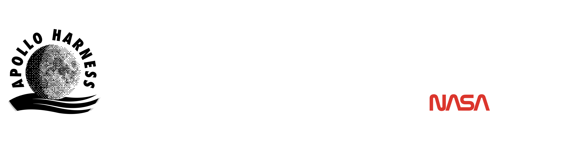

<div align="center">



<br /><br />

<a href="https://apolloharness.web.app"></a>
<a href="https://www.spaceappschallenge.org/2026/challenges/lunar-landing-site-navigator/"></a>
<a href="https://www.spaceappschallenge.org/2026/find-a-team/chhayanautical/"></a>
<a href="https://youtu.be/aGuu1ngPULE"></a>
<a href="./LICENSE"></a>

<br /><br />

<strong>Know your light before you land.</strong><br />
<em>Sunlight, Earth contact and terrain for any landing site on the Moon, computed from NASA data.</em><br />
<sub>Built by <strong>Team Chhayanautical</strong> for the NASA Space Apps Challenge 2026: <a href="https://www.spaceappschallenge.org/2026/challenges/lunar-landing-site-navigator/">Lunar Landing Site Navigator</a></sub>

</div>

---

## Overview

A lander on the Moon depends on two things: **sunlight** for power and a **line of sight to Earth** for communication. Near the poles the Sun skims the horizon, so a ridge a few kilometres away can decide whether a site is lit. A launch that slips by a few days can move arrival into darkness.

**Apollo Harness** turns NASA's planetary data into answers you can read at a glance:

- How long until sunset and Earthset at a site?
- How much sunlight does it get over the next lunar day?
- What does a three-day launch slip cost?

It works for the current CLPS fleet, for past landings used as reference points, and for **any point you click** on the Moon.

It is built for two audiences. **Simple mode** gives plain-language countdowns for classrooms and the public. **Scientific mode** gives the full geometry for mission planners.

**Live:** https://apolloharness.web.app

## Features

| | |
|---|---|
| **3D Moon with the mission fleet** | 15 missions from a primary-sourced catalog: 10 CLPS missions plus 5 landed reference missions (Apollo 11 and 17, Chandrayaan-3, Chang'e 4, SLIM). Pins show only coordinates that were actually published. |
| **Earth and Sun in the sky** | Earth and the Sun are placed along their true directions from each site. The Earth link beam turns red when Earth is hidden behind terrain. |
| **Operational countdowns** | Time to sunset or sunrise and to Earthset or Earthrise, measured against the real LOLA terrain horizon, plus the round-trip light time to Earth. |
| **29.5-day timeline** | Scrub or play through one lunar day; the Sun, Earth, beam and readouts update as you move. |
| **Analyse any point** | Click anywhere on the Moon, or type coordinates. The live engine returns countdowns, upcoming rise and set events, elevation, regional slope and the nearest permanently shadowed region (PSR). |
| **Compare** | Two sites side by side, or **two launch dates** at the same site, to see how a slip changes sunlight and Earth contact. |
| **Simple and Scientific modes** | The same data at two levels of detail. |
| **Data provenance** | Every value cites its NASA product, and missing data is shown as "Unavailable", never as zero. |
| **Works offline** | The catalog, mission tracks, fonts and coarse Moon imagery are bundled. Only clicked points and date comparisons need the live engine. |

## Data and science

All values come from NASA and JPL products. Nothing is estimated or filled in by hand.

| Data | Product | Used for |
|---|---|---|
| Ephemeris | NASA/JPL NAIF SPICE kernels (DE430, Moon PA DE421) | Sun and Earth positions seen from the site |
| South polar terrain | NASA GSFC PGDA product 90: LOLA DEM, 80 m/pixel, 80–90°S | Terrain horizon, elevation, slope |
| Global terrain | NASA PDS LOLA GDR `LDEM_64` (~474 m/pixel) | Terrain horizon everywhere else |
| Shadowed regions | NASA PGDA product 90 PSR map (506,349 polygons, 80–90°S) | Distance to the nearest cold trap |
| Illumination maps | NASA PGDA product 69 | Validation |
| Mission catalog | NASA, LROC, ISRO, CNSA, JAXA and provider sources | `data/missions.json`, with a source for every record |

### Validation

| Check | Result | Details |
|---|---|---|
| Sky positions vs JPL Horizons (DE441) | Sun direction within **0.006°** at 13 sites; 100% agreement on above or below the horizon | `data/validation/horizons_crosscheck.json` |
| Sunlight vs NASA PGDA product 69 | Held-out test on 305 points: **R² 0.951**, mean error **1.45 percentage points** | `data/validation/annual_illumination_validation.json` |
| Earth visibility vs NASA PGDA product 69 | **R² 0.953**, mean error **1.40 percentage points** | `data/validation/earth_visibility_validation.json` |

Method and limits: [docs/ML_VALIDATION_REPORT.md](docs/ML_VALIDATION_REPORT.md), [docs/SCIENTIFIC_BASIS.md](docs/SCIENTIFIC_BASIS.md).

### Data rules

- **Unknown is never zero.** A missing value is shown as "Unavailable", with the reason.
- **Coordinates are labelled honestly.** Only `actual_landing` coordinates are presented as landing points; targets and regions are labelled as such.
- **The terrain model is always shown.** Results say whether real LOLA terrain was used.
- **Countdowns never extrapolate** beyond the computed window.
- **Earth contact is geometric line of sight only**, with no link budget or Deep Space Network scheduling. The slope shown is regional terrain, not lander footing safety.

## Architecture

```
NASA / JPL data (SPICE, LOLA, PSR)
        │
        ▼
Compute engine (Python, src/compute)
        │
        ├──► Precomputed 29.5-day mission tracks ──► bundled with the website
        │
        └──► Live API (FastAPI, backend/), hosted on Render
                    ▲
                    │  clicked points, launch-date comparisons
                    │
Web app (React + TypeScript + CesiumJS, frontend/), hosted on Firebase
```

- **Website:** https://apolloharness.web.app. Deploys from `main` through GitHub Actions to Firebase Hosting.
- **Live API:** https://apolloharness-api.onrender.com (docs at `/docs`). Deploys from `main` as a Docker image on Render. The free instance sleeps after 15 idle minutes; the website wakes it and shows a wait message.

## Repository layout

```
frontend/            Web app: React, TypeScript, Vite, CesiumJS
backend/             FastAPI service exposing the engine
src/compute/         Engine: SPICE geometry, terrain horizons, PSR distance, tracks
src/acquire/         Data download and verification (NASA, NAIF, USGS)
src/ml/              Validation against NASA and JPL references
data/                Mission catalog, precomputed tracks, NASA products (Git LFS)
offline_fixtures/    Offline copies of API payloads for tests and fallback
tests/               Python test suite
docs/                Data setup, sources, science basis and validation reports
Dockerfile           API image used by Render
```

## Getting started

### Prerequisites

- [Git LFS](https://git-lfs.com). Terrain, shadowed-region and SPICE files are LFS objects.
- Python 3.12
- Node.js 20 or newer

### 1. Clone and fetch the data

```sh
git clone https://github.com/k-shopnil/apolloharness.git
cd apolloharness
git lfs pull
```

### 2. Engine and tests (Python)

```sh
python -m venv .venv
# Windows: .venv\Scripts\activate    macOS/Linux: source .venv/bin/activate
pip install -r requirements-dev.txt

python -m src.acquire.verify_data     # must end with: all required data present and verified
python -m pytest -q tests
```

If Git LFS is unavailable, `python -m src.acquire.verify_data --fetch` downloads the files from the original publishers (NASA PGDA, NAIF, USGS) and checks their SHA-256. Every file, with its source, size and checksum, is listed in [docs/DATA_SETUP.md](docs/DATA_SETUP.md).

**Optional:** real terrain away from the south pole needs the global LOLA map (531 MB):

```sh
python -m src.acquire.nasa_products lola_gdr_global_64ppd
```

### 3. Run the API locally

```sh
uvicorn backend.main:app --reload --port 8000
# http://localhost:8000/docs   ·   http://localhost:8000/api/v1/health
```

Or with Docker (includes the global terrain map):

```sh
docker build -t apolloharness-api .
docker run -p 8000:8000 apolloharness-api
```

### 4. Run the web app

```sh
cd frontend
npm ci
npm run dev      # http://localhost:5173
```

By default the app uses the hosted API. To use a local one, run `VITE_API_URL=http://localhost:8000 npm run dev`. Set `VITE_API_URL=` (empty) to build an offline-only site. More details: [frontend/README.md](frontend/README.md).

## API

| Endpoint | Returns |
|---|---|
| `GET /api/v1/health` | Service status, SPICE kernels loaded, engine warm-up |
| `GET /api/v1/missions` | The mission catalog |
| `GET /api/v1/sites/geometry?site_id=` | Sun and Earth geometry and countdowns for a catalog site |
| `GET /api/v1/sites/custom?lat=&lon=&utc=` | Full readout for any point; `include_track=true` adds the 29.5-day track |
| `GET /api/v1/sites/compare-dates?site_id=&date_a=&date_b=` | The same site from two start dates, with the differences |
| `GET /api/v1/sites/sensitivity?lat=&lon=&utc=` | How small changes in position, date and mast height affect results |
| `GET /api/v1/artemis-regions` | NASA's Artemis III candidate regions |

Response shapes and field meanings: [docs/TEAM_INTEGRATION_GUIDE.md](docs/TEAM_INTEGRATION_GUIDE.md).

## Contributing

`main` deploys to production. Changes go through a pull request, and four checks must pass: Python tests, frontend build, data guard, and the change filter. The data guard blocks known mock missions and invented default values.

## Documentation

| Document | Contents |
|---|---|
| [DATA_SETUP.md](docs/DATA_SETUP.md) | Every external file: source, size, checksum, installation |
| [DATA_SOURCES.md](docs/DATA_SOURCES.md) | Source inventory and citation audit |
| [SCIENTIFIC_BASIS.md](docs/SCIENTIFIC_BASIS.md) | Frames, conventions, assumptions, known discrepancies |
| [ML_VALIDATION_REPORT.md](docs/ML_VALIDATION_REPORT.md) | Validation method and results |
| [DATA_PIPELINE_USAGE.md](docs/DATA_PIPELINE_USAGE.md) | Engine functions, units and examples |
| [TEAM_INTEGRATION_GUIDE.md](docs/TEAM_INTEGRATION_GUIDE.md) | API payloads and how the frontend uses them |
| [EVENT_DAY_PLAN.md](docs/EVENT_DAY_PLAN.md) | Hackathon event-day checklist |

## Pitch

<div align="center">
<a href="https://www.youtube.com/watch?v=aGuu1ngPULE"></a>
</div>

## Team

**Apollo Harness** is built and maintained by **Team Chhayanautical** for the NASA Space Apps Challenge 2026.

| | |
|---|---|
| **Team website** | [chhayanautical.web.app](https://chhayanautical.web.app) |
| **Space Apps team page** | [Chhayanautical on Space Apps](https://www.spaceappschallenge.org/2026/find-a-team/chhayanautical/) |
| **Contact** | [chhayanautical@gmail.com](mailto:chhayanautical@gmail.com) |

## Acknowledgements

This project uses data from NASA's Lunar Reconnaissance Orbiter (LOLA, LROC), NASA GSFC's Planetary Geology, Geophysics and Geochemistry Lab (PGDA), the NASA Planetary Data System, JPL's Navigation and Ancillary Information Facility (SPICE) and JPL Horizons, and the NASA Moon Trek imagery service. Apollo Harness is an independent project built on NASA data; it is not an official NASA product.

## License

[MIT](LICENSE) © 2026 Team Chhayanautical
