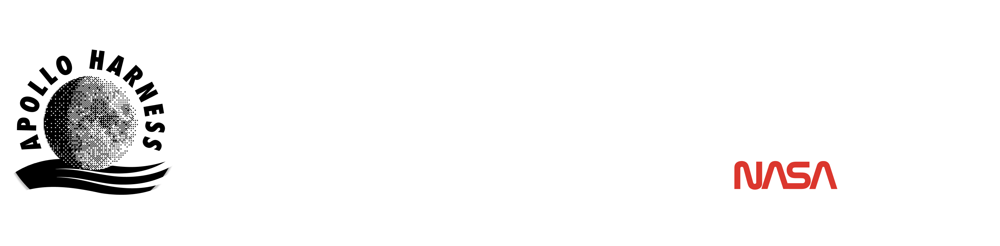

<div align="center">



  <br /><br />

  <a href="https://www.spaceappschallenge.org/2026/challenges/clps-lunar-mission-browser/">
    
  </a>


  <a href="https://www.spaceappschallenge.org/2026/find-a-team/chhayanautical/">
    
  </a>

  <a href="https://chhayanautical.web.app">
    
  </a>

  <a href="https://youtu.be/aGuu1ngPULE?si=Tqs-8-tjcWd688sj">
    
  </a>

  <a href="mailto:chhayanautical@gmail.com">
    
  </a>
    
  </a>

  <br /><br />

  <p align="center">
    <strong>Next-Generation Lunar Mission Intelligence & Environmental Analysis</strong><br>
    <em>Engineered by <strong>Team Chhayanautical</strong> for NASA Space Apps Challenge 2026</em>
  </p>

</div>

---

## The Mission

**HarnessApollo** is an environmental intelligence initiative developed for the **NASA Space Apps Challenge 2026** (Challenge #4: *Commercial Lunar Payload Services (CLPS) Lunar Mission Browser*).

As commercial missions venture into uncharted lunar territories, navigating extreme polar environments demands transforming raw planetary science into intuitive, high-fidelity mission intelligence.

HarnessApollo bridges planetary data archives with next-generation mission planning interfaces to evaluate lunar surface viability and environmental dynamics.

---

## Official NASA Space Apps Pitch

Experience our official preliminary project presentation submitted for the **NASA Space Apps Challenge 2026**.


<div align="center">

  <a
    href="https://www.youtube.com/watch?v=aGuu1ngPULE"
    target="_blank"
    style="position: relative; display: inline-block; width: 700px; max-width: 100%;" >
    
  </a>

</div>

---


## Status & Disclosure

> **Under Active Development**

## Planetary data pipeline

Python compute modules live in `src/compute/`; the mission catalog is
`data/missions.json`, and the offline mission catalog is
`demo_fixtures/missions.json`. The current catalog contains eight CLPS mission
records. Coordinates are references with an explicit `coordinate_type`; a
target or region center must not be interpreted as an achieved landing point.
Dates containing only a year are target years, not exact dates.

### Sources, datasets, and coordinate assumptions

The required SPICE kernels are `data/spice/naif0012.tls` (UTC/leap seconds),
`pck00010.tpc` (body constants), `moon_080317.tf` (lunar frame definitions),
`moon_pa_de421_1900-2050.bpc` (Moon PA orientation), and `de430.bsp` (solar
system ephemerides). The large binary kernels are ignored by Git; obtain the
same named kernels from NAIF's generic kernels and place them in `data/spice/`.
SPICE calculations use `MOON_PA`, east-positive
longitude, planetocentric latitude converted through the Moon radii, and
geometric (no aberration correction) line of sight. Earth visibility is a
spherical-horizon test. It does not include terrain masking, lander antenna
constraints, or relay availability.

Terrain analysis uses NASA GSFC PGDA product 90's 80–90°S LOLA DEM at 80 m/pixel,
which covers the Mons Mouton and Shackleton benchmark coordinates. The registry
downloads it to `cache/nasa/pgda/` and links it at
`data/lola/LDEM_80S_80MPP_ADJ.TIF`; the raster is ignored by Git. Product 90
uses south-polar stereographic coordinates in meters referenced to the
MOON_ME/DE421 realization and a 1,737,400 m reference sphere. Product 81 is a
finer 5 m/pixel mosaic covering only 87–90°S, so it does not cover Mons Mouton.
The acquired product-90 TIFF's WKT uses an IAU Moon-2015 ocentric CRS label;
see [SCIENTIFIC_BASIS.md](docs/SCIENTIFIC_BASIS.md) for the metadata discrepancy
and its effect on interpretation.
The horizon output depends on observer height, radial step, and DEM resolution;
incomplete rays remain unavailable rather than implying open sky.

Annual illumination is a distinct strategic product. The registry downloads
NASA PGDA product 69's 85–90°S, 60 m/pixel and 75–90°S, 120 m/pixel GeoTIFFs to
`data/illumination/`. NASA describes these maps as average solar illumination
over hourly samples spanning about one 18.6-year lunar nutation cycle. The
TIFF's scale metadata (0.00004) converts stored int16 values to fraction of
time illuminated; the API converts that to percent. These are average products,
not mission-window predictions. Use the broader 75–90°S product for Mons
Mouton; the higher resolution 85–90°S product covers Shackleton.

PSR proximity uses NASA PGDA product 90's full south-polar PSR shapefile. The
four shapefile components are downloaded to `cache/nasa/pgda/` and linked into
`data/psr/`; no data binaries are committed. Distances are calculated in meters
after projection to a south-polar stereographic CRS using the ME reference
sphere, not from latitude/longitude differences.
The acquired NASA vector contains 506,349 polygons, including ten invalid
source geometries; the strict proximity calculation rejects the full source
and reports no distance until a validity policy is established.

### Offline operation and reproducibility

`src/acquire/safe.py` implements online → `cache/` → committed fixture fallback
for JSON and file downloads. The committed mission JSON fixture keeps the
mission catalog available offline; compute modules that depend on binary
ephemerides still require the local SPICE kernels. NASA science rasters and PSR
vectors are not replaced by fixture values. Fixture outputs are for software
and offline testing and are NOT scientific results. Analysis output includes
its analysis type and source path. For
reproducibility, record the exact source product/version, kernel filenames,
observer coordinate convention, DEM sampling parameters, and mission start and
duration with each result.

Install pinned dependencies with `python -m pip install -r requirements.txt`.
Run an offline geometry example from the repository root with:

```sh
python -m src.compute.spice_engine
```

LOLA tactical illumination can be called from Python using
`extract_horizon_mask(...)` and `calculate_mission_illumination(...)`;
annual illumination and PSR distance are exposed as
`calculate_annual_illumination(...)` and `calculate_psr_distance(...)`.
Earlier aliases remain available. The compute API raises a
clear `FileNotFoundError` when its scientific input product is not installed.
Run the included checks with `.venv/bin/python -m unittest discover -s tests -v`
and use `.venv/bin/python -m compileall src` for a syntax check. No benchmark
datasets are committed. The scientific basis document records an attempted
real raster sample and its discrepancy with the brief's reference value;
benchmark values must not be claimed until all matching products and time
windows are identified and run.

For downstream API and frontend field mappings, public function signatures,
units, examples, dataset paths, and validation limitations, see
[docs/DATA_PIPELINE_USAGE.md](docs/DATA_PIPELINE_USAGE.md).
Current-epoch SPICE geometry is a kernel-based prediction, not a live lunar
measurement. Registered NASA products expose local cache/integrity status and
verification timestamps; these timestamps do not claim that NASA updated the
underlying historical product. The pipeline does not consume live CLPS
telemetry.

---

## Team & Contacts

**HarnessApollo** is engineered and maintained by **Team Chhayanautical**.

| Channel | Link / Address | Description |
|----------|----------|----------|
|  **Official Website** | [chhayanautical.web.app](https://chhayanautical.web.app) | Mission portal & live web deployment |
| **NASA Space Apps Team Finder** | [Chhayanautical @ NSAC Finder](https://www.spaceappschallenge.org/2026/find-a-team/chhayanautical/) | Official team registration & participant roster |
| **Contact** | [chhayanautical@gmail.com](mailto:chhayanautical@gmail.com) | Official team contact & inquiries |

---

## License

This project is licensed under the LICENSE © 2026 Team Chhayanautical.
